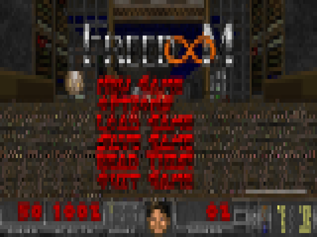
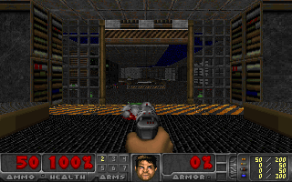

# doom: DOOM in Claude Code

A Claude Code mod that plays DOOM in the side pane. The engine is [doomgeneric](https://github.com/ozkl/doomgeneric). The game data is [Freedoom](https://freedoom.github.io/), which `/doom download` fetches for you, or your own DOOM WAD.

| Any terminal: quadrant cells | kitty / Ghostty: real pixels |
| --- | --- |
|  |  |

These pictures are rendered from the game's own output: the left one simulates how a terminal draws the cells, the right one is the raw frame an Image shows.

## Install

At the prompt of a Claude Code terminal session:

```
/plugin install doom --marketplace emirtuncer/doom-mod
```

Answer `y` to add the marketplace, then pick a scope (user scope is first; press Enter).

From a shell:

```
claude plugin install doom --marketplace emirtuncer/doom-mod
```

## Game data

The repository holds no game data. Before the first game, pick one:
- **Freedoom:** type `/doom download`. It fetches [Freedoom 0.13.0](https://github.com/freedoom/freedoom/releases/tag/v0.13.0) (24 MB) with `curl` and unpacks it into `~/.claude/doom/` with `tar` (or `unzip`).
- **Your own WAD:** set `DOOM_WAD` to its path (for example `doom1.wad` or `doom.wad`) before starting Claude Code.

The mod looks for the WAD in three places, in this order:
1. `DOOM_WAD`;
2. the mod's own `wad/freedoom1.wad`;
3. `~/.claude/doom/`.

## Play

1. Type `/doom`. The game opens in the side pane, straight into the first level.
2. Click the line under the picture to give the game the keyboard; `Esc` takes it back.
3. Type `/doom stop` to quit.

| Key | Action |
| --- | --- |
| `W` `S` / `↑` `↓` | forward, back |
| `A` `D` / `←` `→` | turn |
| `Q` `E` | strafe |
| `Space` / `F` | fire |
| `R` | use (doors, switches) |
| `1`–`7` | weapons |
| `Tab` | map |
| `P` | menu (`Esc` is the terminal's) |
| `Enter` | select |

A terminal reports key presses but not releases, so a key counts as held while it repeats.

**Picture quality.** Two modes, picked by itself:
- **Pixels**, in kitty and Ghostty: the 320×200 frame drawn as a real image. WezTerm is tried too.
- **Cells**, everywhere else (Windows Terminal and xterm.js terminals included): each cell is a 2×2 quadrant glyph in two colours, up to 160 cells wide, which is DOOM's own width.

If the terminal refuses the image, the mod falls back to cells. To pick a mode yourself, set `DOOM_MODE=pixels` or `DOOM_MODE=cells` before starting Claude Code.

In cells mode a wider pane and a smaller font give a sharper picture. `/doom` asks for a 162-column pane; drag the divider if your terminal keeps it narrower.

There is no sound.

## How it works

- `bin/<platform>/doom-claude` is doomgeneric with a platform layer (`engine/doomgeneric/doomgeneric_claude.c`) that opens no window. It writes each frame to stdout, as cells (base64 of a Raster's cells) or, in pixels mode, as raw RGB in a few files used in turn.
- The mod (`hooks/register.tsx`) runs it with `$.process.spawn` and blits each frame into the pane: a `Raster` for cells, an `Image` for pixels. If the terminal refuses the image, it falls back to cells.
- A `Client` region (`hooks/keys.tsx`) catches key presses. The mod writes them to a small file, which the game reads every tick, since a spawned process takes its stdin once.

Builds: Windows x64, Linux x64 (static), macOS arm64 and x64. Only the Windows and Linux builds have been run so far.

## Build the engine

```
sh engine/build.sh /path/to/zig
```

This needs [zig](https://ziglang.org) 0.13, and builds every platform from any of them. `engine/doomgeneric` is doomgeneric at upstream commit `e257a09`, with `doomgeneric_claude.c` added.

## License

GPL-2.0, as doomgeneric is (see `LICENSE`). Freedoom, fetched by `/doom download`, comes under its own BSD-style license. DOOM is a trademark of id Software; this project is not affiliated with id Software.
